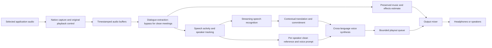

**A2A — local live translation in the original speaker's voice**

Architecture proposal, 23 October 2026. This is a researched implementation plan; latency, model quality, and device compatibility still require measurement.

The current execution baseline is [IMPLEMENTATION_PLAN.md](IMPLEMENTATION_PLAN.md), revision 2.1. It supersedes implementation choices below where they differ, particularly the Swift-first Mac boundary, XPC transport, closed-unit translation baseline, and milestone gates. This document retains the product requirements and original architectural rationale; the reviewed execution plan governs the first implementation tasks.

The product captures audio from another application, translates its speech, and plays the translation using the source speaker's voice identity. It should work for meetings and eventually movies, preserve music and sound effects as closely as possible, and prefer local inference on Apple silicon and Windows hardware. Lip synchronization is outside the current scope.

The recommended sequence is a macOS meeting prototype, a usable macOS meeting app, Windows support, then cinematic dialogue replacement and broader NPU optimization. A two-week feasibility phase must establish voice quality and sustained speed before we commit to a release schedule.

The 1–2 second delay is a warm-session engineering target for supported hardware and ordinary speech. A newly encountered speaker needs a voice reference first. Dense movie soundtracks, overlapping speakers, long clauses, and small devices can require additional delay. Exact background preservation is possible when separate dialogue and music/effects tracks are available; a mixed soundtrack requires estimated separation.

1. **Define the first deliverable around a single clear use case.**

   Start with Mandarin Chinese to English, one selected meeting application, one active speaker at a time, headphones, and entirely local processing after model download. The translated speech must retain the source speaker's recognizable identity. Include original and translated captions, a translation toggle, original-voice monitoring, and visible states for preparing a voice and falling behind.

   After the first setup, launching the app can restore the selected source, target language, and processing mode automatically. Initial setup includes system capture permission and model downloads. The microphone is unnecessary for translating incoming computer audio. Returning translated microphone audio to other meeting participants is a separate feature.

   Keep the source audio audible with captions while collecting an unfamiliar speaker's voice. Switch to the translated voice once the profile passes quality checks. This avoids silently substituting an unrelated narrator. An optional reference supplied before a session can remove most of the voice preparation delay.

2. **Use native audio adapters around a shared engine.**

   WASAPI is the Windows capture interface. On macOS, use Core Audio process taps, available from macOS 14.2, with a private aggregate device. Apple's sample documents capture of selected processes, capture permissions through `NSAudioCaptureUsageDescription`, and tap-controlled muting. Start with selected applications and add whole-system capture later. Resolve browser and meeting helper processes as part of the source application. These are application-level sources; individual browser tabs need additional integration. [Apple Core Audio taps](https://developer.apple.com/documentation/coreaudio/capturing-system-audio-with-core-audio-taps), [Microsoft WASAPI loopback](https://learn.microsoft.com/en-us/windows/win32/coreaudio/loopback-recording).

   Establish a clean capture → replay path before adding AI. Exclude the translator and its helper processes from capture. Verify that the tap continues supplying samples while suppressing direct playback. Use the tap's mute lifecycle to restore ordinary sound on stop or failure, and test crash recovery explicitly. A capture-only ScreenCaptureKit adapter is a possible fallback; dialogue replacement also needs a verified way to control original playback. [Apple tap mute behavior](https://developer.apple.com/documentation/coreaudio/catapmutebehavior).

   On Windows, use WASAPI process loopback for the selected application's process tree. Microsoft's sample supports process-tree inclusion and exclusion. Target Windows 11; the modern Windows ML provider path requires 24H2 or later. Capture and suppression are separate capabilities: plan a virtual render endpoint for reliable replacement, route source audio there, and render processed audio directly to the physical output. The prototype can use an existing virtual endpoint; distributing one requires a driver licensing, signing, installation, and recovery workstream. Ordinary session muting must be tested for its effect on captured samples before considering it an alternative. [Microsoft process loopback sample](https://github.com/microsoft/Windows-classic-samples/tree/main/Samples/ApplicationLoopback).

   Build the real-time engine in C++ with a narrow C interface, a SwiftUI macOS shell, and a WinUI Windows shell. Share buffering, scheduling, speaker state, model contracts, and telemetry. Keep native capture, device handling, permissions, and runtime bindings in platform adapters.

3. **Separate audio deadlines from AI workloads.**

   Preserve stereo audio at a 48 kHz floating-point internal format, converting at device boundaries. Create model-specific mono/resampled branches for recognition, speaker analysis, and synthesis. Preserve original timestamps through every conversion. Keep a short circular buffer, initially capped at ten seconds, for reference selection and recovery.

   Audio callbacks perform bounded copies and buffer reads only. They must avoid allocation, locks, file access, inference, and UI work. Run inference in a supervised local worker with shared-memory audio buffers. Start research experiments in Python, then move the chosen streaming paths into native or packaged runtimes. A Python demonstration alone does not establish shipping performance.

   Use a single output timeline, measure capture/output clock drift, and apply adaptive resampling when separate device clocks require it. Device changes, sleep/wake, source restarts, and seeks cancel outdated inference and synthesis using session and segment IDs. Exclude all playback workers from capture, including when the user enables whole-system mode.

   Keep models resident, prepare voice conditioning once per speaker, and warm inference before taking over playback. Use a bounded queue. If inference falls behind, return to original audio with captions and a visible status. Do not accumulate an increasing interpretation delay or silently omit content.

4. **Create a voice profile from the actual source speaker.**

   Speech activity detection locates usable speech. Online speaker embeddings and clustering assign session-local speaker IDs. Collect clean, non-overlapping voiced frames for each ID, reject music-contaminated or distorted samples, and build the synthesis model's reference conditioning. Store source-language reference transcripts when the chosen model benefits from them.

   Keep the profile fixed during playback and update it only after a clearly better sample is available. Every translated segment carries a speaker ID, source time range, and profile version. This prevents one speaker's voice from leaking into another's output when diarization revises a label. Overlap detection is necessary even before supporting overlapping translation: the initial behavior is original audio plus captions for those spans.

   Evaluate roughly 3, 6, and 10 seconds of clean voiced reference. Qwen3-TTS Base advertises cloning from three seconds; that is reference duration, not total startup time or a guarantee on noisy meeting audio. A practical initial acquisition allowance is 5–15 seconds of elapsed speech, sometimes longer with pauses or poor audio. Already prepared speakers avoid that acquisition step. [Qwen3-TTS model descriptions](https://github.com/QwenLM/Qwen3-TTS).

   Voice identity, pronunciation, and emotional delivery are separate evaluation dimensions. Preserve recognizable timbre and broad delivery while producing intelligible target-language pronunciation and rhythm. Mandarin pitch contours cannot simply be copied onto English syllables. Begin with identity and naturalness; add fine-grained emotional transfer after the basic path works.

   Speaker profiles stay local and session-scoped by default, with explicit save/delete controls. The original audio provides the reference; enrollment does not require each speaker to record English training material.

5. **Benchmark a small model set and retain replaceable stage interfaces.**

| Stage | Starting implementation or candidate | Decision to validate |
| --- | --- | --- |
| Speech activity and speaker tracking | Small VAD plus a speaker embedding model and online clustering | False speech triggers, identity changes, and CPU cost |
| Streaming recognition | sherpa-onnx Chinese/English streaming models; Apple SpeechAnalyzer on supported systems | Recognition quality at short context and actual device latency |
| Recognition challenger | Qwen3-ASR 0.6B | Accuracy benefit versus porting effort, memory, and streaming availability |
| macOS translation | Apple Translation framework on supported OS versions and language pairs | Clause quality, model readiness, and request latency |
| Shared translation | Quantized TranslateGemma 4B; compare a small non-thinking Qwen translator if context/glossary control is needed | Speed and translation quality on incremental clauses |
| Speaker-preserving synthesis | Fun-CosyVoice3 0.5B cross-language cloning with streaming | Native macOS/Windows streaming, identity retention, and sustained speed |
| Synthesis challenger | Qwen3-TTS 0.6B Base; 1.7B quality comparison | Reference quality and the exact local streaming implementation |
| Movie separation | Bandit/DnR as an offline quality reference, followed by a causal or limited-lookahead separator | Background damage and end-to-end algorithmic delay |

   sherpa-onnx provides offline-capable native runtimes and streaming model options. Apple documents live on-device transcription and on-device text translation. Runtime language/model checks are required; the Apple recognition path uses newer OS APIs than the basic Core Audio capture layer. For the first packaged Mac alpha, targeting macOS 26 simplifies the system recognition path; macOS 15 support can use sherpa-onnx plus Apple Translation. [sherpa-onnx](https://github.com/k2-fsa/sherpa-onnx), [Apple SpeechAnalyzer](https://developer.apple.com/videos/play/wwdc2025/277/), [Apple Translation](https://developer.apple.com/videos/play/wwdc2024/10117/).

   Qwen3-ASR's documented streaming implementation currently uses vLLM and lacks streaming timestamps. Treat a native Apple/AMD streaming port and approximate segment timing as explicit work if this model wins. TranslateGemma is a text translation model; making it useful for simultaneous interpretation requires our incremental commitment policy. [Qwen3-ASR streaming documentation](https://github.com/QwenLM/Qwen3-ASR), [TranslateGemma model card](https://huggingface.co/google/translategemma-4b-it).

   CosyVoice3 documents cross-language voice cloning and streaming text input/audio output. Qwen3-TTS offers short-reference cloning. Their published synthesis latency figures are model-level results under specific conditions. Reproduce streaming with the exact chosen checkpoint and runtime, including cached references and realistic clause lengths. Neither those figures nor parameter counts establish a 1–2 second complete pipeline on a laptop. [CosyVoice3 implementation](https://github.com/QwenAudio/CosyVoice), [Qwen3-TTS technical report](https://arxiv.org/abs/2601.15621).

   Pin model, tokenizer, runtime, and conversion versions. Record the licenses for the actual weights and exported artifacts. SeamlessStreaming/Expressive are useful research comparisons for simultaneous and expressive translation, but the published model licenses include noncommercial or separate terms, so they are not the default product dependency. [Meta model capabilities and licenses](https://github.com/facebookresearch/seamless_communication).

6. **Commit speech in meaningful increments.**

   A real-time recognizer emits revisable hypotheses. Translate short semantic units with preceding context and preserve a committed target prefix. Show tentative text immediately, but synthesize only committed text. Once spoken, a translation cannot be revised unobtrusively.

   Compare a stable-prefix policy against a small wait-k or adaptive wait policy. Tune an initial 0.4–0.9 second context window, with extra waiting when word order, negation, numbers, or an unfinished clause makes an early translation unreliable. Feed committed text chunks to a continuous synthesis context so each fragment does not restart the voice or prosody.

   For ordinary short clauses, target the following incremental critical path after models and the speaker profile are ready. These are proposed budgets, not benchmark results. Stages overlap in steady operation; capture the actual event trace rather than adding independent p95 values.

| Contribution | Proposed budget |
| --- | --- |
| Capture and framing | 20–40 ms |
| Movie dialogue extraction, when enabled | 80–250 ms target; requires a suitable streaming model |
| Enough source context to commit the next phrase | 400–900 ms |
| Recognition processing beyond that input window | 80–200 ms |
| Translation of the committed increment | 150–450 ms |
| First playable audio in the prepared source voice | 150–350 ms |
| Playout buffer and device path | 40–100 ms on the wired reference setup |

   The illustrative sum is about 0.84–2.04 seconds for clean meetings and 0.92–2.29 seconds with the proposed movie separator. Larger models, additional semantic waiting, or queued speech can exceed these budgets. Bluetooth output needs separate measurement. Count voice acquisition and model loading separately and expose both to the user.

   Launch targets for a supported warm meeting profile are median phrase-onset-to-corresponding-audio delay at or below two seconds and p95 at or below four seconds. A stricter p95 two-second requirement is a separate feasibility goal. Report sustained translation coverage and queue depth alongside latency so a fast first packet cannot hide later backlog.

   Measure translated speech duration as well as inference speed. English output can take longer to say than its Mandarin source. First adjust synthesis pacing within a modest natural range; if the queue remains excessive, expose the delay and fall back to original audio/captions. The default mode preserves meaning. Any later condensed interpretation mode must be explicit.

7. **Treat movie dialogue replacement as its own research milestone.**

   A mixed movie track contains dialogue, music, effects, reverb, and sometimes singing or simultaneous speech. Capture APIs supply that mixture. Cinematic source separation estimates the components; the DnR/Bandit work provides a relevant quality benchmark. A music vocal-removal model alone does not establish preservation of film sound effects or singing. [DnR multilingual cinematic separation research](https://arxiv.org/abs/2407.07275), [Bandit implementation](https://github.com/kwatcharasupat/bandit-v2).

   Prefer available dialogue and music/effects stems when a controlled player provides them. For generic loopback audio, estimate a stereo background bed and dialogue branch. Enforce mixture consistency where practical, preserve stereo phase relationships, and evaluate residual dialogue and removed background content separately. Subtracting an estimated voice from the mixture also subtracts its estimation errors; it is an experiment, not a fidelity guarantee. Center-channel attenuation is only a comparison baseline.

   The desired output is the estimated background bed plus newly synthesized translated speech. Preserve music/effects at original gain and timing as closely as the separator allows. Keep the background branch running continuously so speech pauses do not pump music levels.

   Default external-player behavior plays the background as soon as separation permits and overlays translated dialogue later. This preserves near-original music/effects timing while accepting delayed dialogue. An optional coherent-soundtrack mode delays the bed to match translated dialogue; the entire soundtrack then trails the video. Lip sync is excluded, but these timing choices still affect explosions, scene changes, and overlapping dialogue, so validate them with users. A later built-in player can read ahead and schedule video/audio together.

   Begin separation tests with offline reference models. Measure required future context before trying shorter chunks; splitting an offline model into chunks does not make it causal. If the quality baseline needs several seconds, either provide a higher-delay movie mode or train/distill a causal or limited-lookahead separator. Keep a low-latency movie claim gated on this result. Broad soundtrack coverage and artifact-free removal remain open research risks.

8. **Use the best measured local accelerator for each stage.**

| Platform | Runtime plan | Initial allocation hypothesis |
| --- | --- | --- |
| Apple silicon | Core ML for compatible exported graphs; Metal/MLX or another native GPU runtime for generative models | CPU for audio/control; ANE candidates for compact encoders and separator subgraphs; GPU for autoregressive translation and cloned speech |
| AMD Ryzen AI on Windows | ONNX Runtime/Windows ML VitisAI provider for supported NPU graphs; GPU runtime for remaining models | NPU candidates for fixed-shape VAD, speaker/ASR encoders, and separation; GPU/CPU for decoding and synthesis where needed |
| NVIDIA RTX on Windows | CUDA/TensorRT or Windows ML TensorRT-RTX where the exact graph is supported | GPU/Tensor Cores for demanding inference; CPU for audio/control |
| AMD Radeon on Windows | Qualify a GPU backend per model; DirectML as a compatibility candidate and MIGraphX for eligible graphs | GPU acceleration with explicit operator and generative-model support checks |

   Core ML can permit Neural Engine execution, but runtime scheduling and operator support determine actual placement. MLX documents CPU/GPU execution. Export compatible training graphs to Core ML and ONNX separately, keep streaming state explicit, and profile actual hardware placement and fallback. Do not infer ANE use from a model successfully loading. [Apple compute units](https://developer.apple.com/documentation/coreml/mlcomputeunits), [MLX supported devices](https://github.com/ml-explore/mlx).

   Windows ML lists vendor-specific providers for AMD and NVIDIA. The AMD NPU path depends on the exact Ryzen AI device, driver, compiler, graph operators, and tensor shapes. Current Windows ML documentation also flags limitations for generative workloads on its MIGraphX provider. Capture a provider compatibility matrix instead of assuming any ONNX graph runs on every accelerator. [Windows ML providers and requirements](https://learn.microsoft.com/en-us/windows/ai/new-windows-ml/supported-execution-providers), [AMD NPU compilation](https://ryzenai.docs.amd.com/en/latest/modelrun.html).

   Begin with a complete CPU/GPU pipeline, then migrate suitable subgraphs to NPU/ANE when that improves measured latency, power, or GPU availability. Autoregressive decoding, dynamic shapes, streaming caches, and vocoders can require different execution paths. A fully NPU-resident pipeline is a later optimization objective.

   Use static or bounded-shape exports for streaming encoders where needed, calibrate quantization on representative Chinese/English audio, cache compiled artifacts, and include transfer/synchronization costs in measurements. Prioritize source reference fidelity when quantizing speaker encoders and voice synthesis. Benchmark the whole pipeline while a meeting or movie is also consuming CPU/GPU resources.

   Initial qualification machines should include an Apple silicon Mac with 24–32 GB memory, a Windows RTX system with 12–16 GB VRAM, and a Ryzen AI system with 32 GB RAM. These are development targets, not validated minimum requirements. Add a 16 GB Apple silicon configuration as a lower-memory meeting target. Measure peak resident memory and caches before setting minimum specifications; initial full-pipeline memory planning should allow roughly 6–12 GB, with substantial variation by model and runtime.

9. **Make acceptance tests determine the supported product.**

   Build a repeatable audio replay harness before polishing the interface. It must run recordings at real-time speed, include source timestamps, and collect stage timings, emitted audio, speaker decisions, queue depth, memory, power, and device/provider placement. Compare unquantized and shipping models using the same clips.

   Use at least twenty reference speakers and a held-out Mandarin/English corpus covering meetings, accents, code switching, technical names, dates, numbers, negation, background music, and speaker transitions. Include known dialogue/music/effects stems and a separate set of real movie excerpts. Evaluate with bilingual listeners; translation metrics alone miss omitted negation and changed numbers.

| Property | Proposed gate |
| --- | --- |
| Warm meeting latency | Median ≤2 s; p95 ≤4 s on each qualified reference configuration |
| Sustained operation | No increasing queue depth during 60-minute real-time playback; investigate every underrun |
| Translation quality | Bilingual human adequacy ≥4/5 on the defined clean-meeting set; separately report omissions and critical factual errors |
| Speaker identity | Blind cross-language matching ≥90% among five candidate source speakers; verify with an independent speaker embedding metric |
| Speech naturalness | Listener rating ≥4/5 on the same held-out speakers, including short clauses |
| Voice readiness | Report median and p95 clean voiced seconds and elapsed seconds required for each new speaker |
| Movie background | Stem-based quality measurements plus ≥4/5 human preservation rating; no artifact-free claim from a single metric |
| Silence/music behavior | Report false synthesized speech and song/dialogue confusion; investigate every failure in the initial set |
| Audio lifecycle | No feedback, duplicate direct playback, or stranded mute state across stop, crash, permission denial, sleep, and output-device changes |
| Local processing | After initial downloads, complete the meeting test with networking disabled |

   Calibrate similarity and separation thresholds using human judgments before turning them into release gates. Do not use a universal speaker cosine threshold across languages and models. Keep hard examples as their own reported slices rather than hiding them inside a mean score.

10. **Deliver in gated phases.**

| Elapsed time | Deliverable | Evidence required to continue |
| --- | --- | --- |
| Weeks 1–2 | Capture/replay spike plus local recorded-speech translation in the original voice | Working mute/replay lifecycle; reference-length comparison; native Mac streaming proof; latency and memory traces |
| Weeks 3–6 | macOS single-speaker meeting alpha | Continuous recognition/translation/synthesis; stable voice prompt; bounded queue; offline operation |
| Weeks 7–8 | Multi-speaker meeting beta and packaging | Speaker transitions, overlap fallback, permission/device recovery, signed application, held-out quality report |
| Weeks 9–12 | Windows capture/routing and RTX meeting parity | Virtual endpoint plan resolved; native runtime and installer validation; equivalent replay results |
| Weeks 13–20 | Movie research release and AMD NPU qualification | Separator quality/lookahead gate, music/effects listening tests, AMD provider profiles, sustained combined-load tests |

   This is a planning estimate for roughly three experienced contributors covering native audio, speech/model systems, and application/test integration. Cinematic separation and model ports can extend it. A solo implementation should plan a longer sequence. AMD graph experiments can begin early on recorded fixtures, but full AMD support is accepted only after the complete pipeline passes on actual hardware.

   The two-week report should make a concrete decision: which Mac recognition/translation/synthesis combination provides convincing same-speaker output, which latency target it meets, and what porting remains. If identity or streaming speed fails, spend the next iteration on that bottleneck before building a broad UI or adding languages.

   The first executable milestone is therefore: capture one Mac application's Chinese speech, collect a short clean voice reference, and continuously play intelligible English in that speaker's recognizable voice while all processing stays local. That establishes the essential product behavior before extending it to arbitrary soundtracks and hardware.
